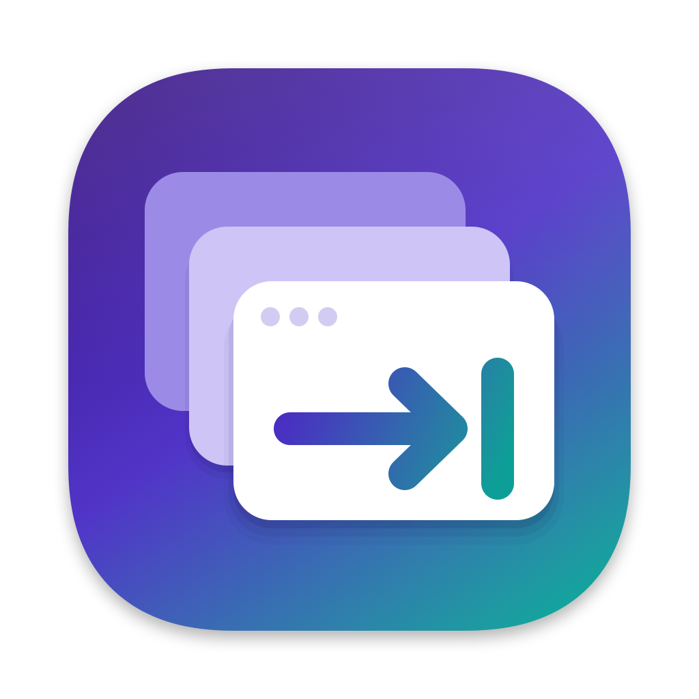

<p align="center"></p>

# BetterAltTab

**Website: [stanimir93.github.io/BetterAltTab](https://stanimir93.github.io/BetterAltTab/)**

BetterAltTab is a window switcher for macOS: press <kbd>⌘</kbd> <kbd>⇥</kbd> and it shows every open window, not only every app, so you can jump straight to the one you want.

It is a personal, simplified fork of [AltTab](https://github.com/lwouis/alt-tab-macos) by [lwouis](https://github.com/lwouis) and its contributors. Nearly all of the code is theirs. This fork is not affiliated with or supported by the AltTab project; if you want the maintained app, use AltTab.

## How it differs from AltTab

- Every feature is included. There is no Pro version, trial or license key.
- Settings fit on one simple page.
- No automatic updates. You update by building a newer version yourself.
- Nothing is sent anywhere: no crash reports, no feedback form.
- <kbd>⌘</kbd> <kbd>⇥</kbd> opens the switcher by default, and <kbd>⌘</kbd> <kbd>⇧</kbd> <kbd>⇥</kbd> opens it in reverse.
- It never plays the macOS alert sound.

## Permissions

macOS asks for two permissions the first time you run it:

- **Accessibility**, to read the keyboard shortcuts and to list, focus and manage windows. The app can't work without it.
- **Screen Recording**, to show window thumbnails and previews. Without it, the switcher still works but can't show what's inside each window.

You can grant both in System Settings > Privacy & Security.

## Build and install from source

There are no prebuilt downloads. You need a Mac with Xcode installed (the app itself runs on macOS 12 or later).

1. Clone this repository and open a terminal in it.
2. Create a local code-signing certificate, once per Mac. A stable signature means macOS remembers the permissions above across rebuilds.

   ```sh
   scripts/codesign/setup_local.sh
   ```

3. Create `config/local.xcconfig` (it's ignored by git) so the Release build signs with that certificate:

   ```
   CODE_SIGN_IDENTITY = Local Self-Signed
   OTHER_CODE_SIGN_FLAGS = --timestamp=none --deep --options runtime
   ```

4. Build the Release scheme:

   ```sh
   xcodebuild -project alt-tab-macos.xcodeproj -scheme Release -derivedDataPath DerivedData
   ```

5. Quit BetterAltTab if it's running, then copy the app to `/Applications` and open it:

   ```sh
   ditto DerivedData/Build/Products/Release/BetterAltTab.app /Applications/BetterAltTab.app
   open /Applications/BetterAltTab.app
   ```

For development, `ai/build.sh` builds the Debug scheme and `ai/test.sh` runs the unit tests. [AGENTS.md](AGENTS.md) has the coding conventions.

## Credits and license

BetterAltTab is based on [AltTab](https://alt-tab.app) by [lwouis](https://github.com/lwouis) ([source](https://github.com/lwouis/alt-tab-macos)), built by [these contributors](docs/contributors.md). It uses the third-party libraries listed in [docs/acknowledgments.md](docs/acknowledgments.md).

Like AltTab, it is free software under the [GNU General Public License v3](LICENCE.md).
